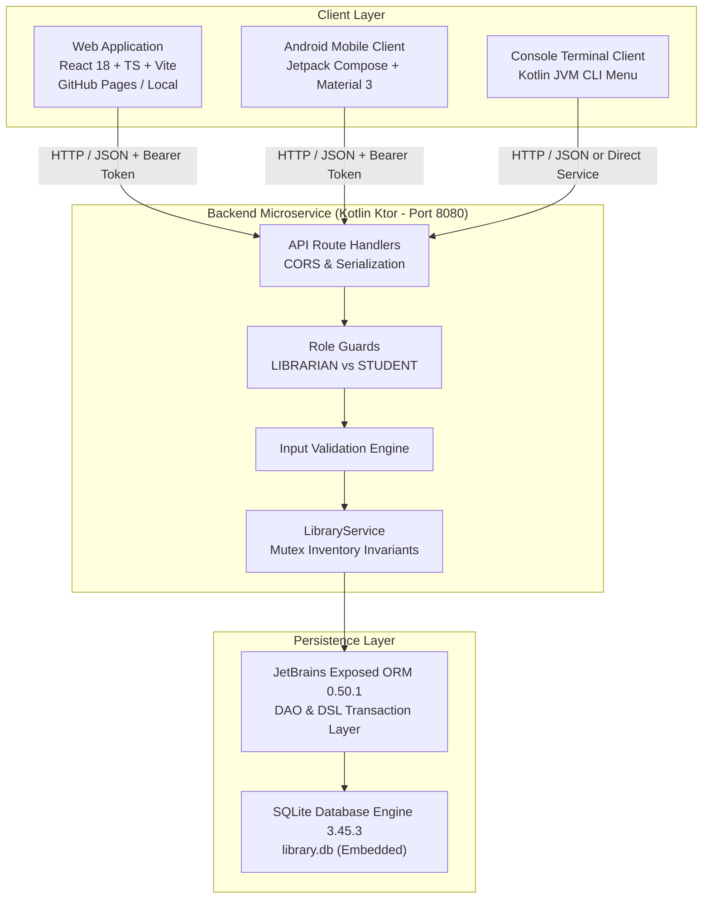

# IEM Library Management System
**Institute of Engineering & Management (IEM), Kolkata**  
*Unified Academic Library Operations & Digital Catalog System*

[](https://yashvipandey06.github.io/iem-library-management-system/)
[](https://github.com/YashviPandey06/iem-library-management-system)
[](https://kotlinlang.org/)
[](https://ktor.io/)
[](https://react.dev/)
[](https://www.typescriptlang.org/)
[](https://vitejs.dev/)
[](https://tailwindcss.com/)
[](https://www.sqlite.org/)
[](https://www.docker.com/)

---

## 🌐 Live Website & Links

- **Live Deployed Website**: [https://yashvipandey06.github.io/iem-library-management-system/](https://yashvipandey06.github.io/iem-library-management-system/)
- **GitHub Repository**: [https://github.com/YashviPandey06/iem-library-management-system](https://github.com/YashviPandey06/iem-library-management-system)
- **Deployment Platform**: GitHub Pages via GitHub Actions (Continuous Deployment on `main`)

---

## 1. Project Overview

The **IEM Library Management System** is an enterprise-grade, full-stack digital library management platform engineered for the **Institute of Engineering & Management (IEM), Kolkata**. The system replaces manual register logs and fragmented software with a unified, transactional, service-oriented architecture designed to handle academic cataloging, multi-copy physical inventory tracking, student patron circulation, and administrative auditing.

### Primary Capabilities:
- **Digital Academic Catalog**: Real-time searchable index of all textbooks, references, and monographs.
- **Physical Inventory Conservation**: Strict mathematical enforcement of copy availability ($0 \le \text{availableCopies} \le \text{totalCopies}$).
- **Role-Based Access Control**: Dedicated portals for Student Patrons and Library Administrators.
- **Living Library User Experience**: Immersive digital library environment featuring interactive 3D physical book cards and parallax visual depth.
- **Multi-Client Architecture**: Serves Web, native Android (Jetpack Compose), and terminal CLI clients from a single high-performance Kotlin backend.

---

## 2. System Architecture



---

## 3. Technology Stack Matrix

| Layer | Technology | Version | Purpose |
|---|---|---|---|
| **Frontend Framework** | React | 18.2.0 | Declarative component UI |
| **Frontend Language** | TypeScript | 5.2.2 | Type safety & interface contracts |
| **Frontend Bundler** | Vite | 5.1.6 | Fast HMR dev server & production bundling |
| **Frontend Styling** | Tailwind CSS | 3.4.1 | Utility-first responsive styling |
| **Frontend Icons** | Lucide React | 0.344.0 | Clean SVG icon library |
| **Routing** | React Router DOM | 6.22.3 | Hash-based static routing for GitHub Pages & web servers |
| **Backend Framework** | Ktor (Netty) | 2.3.12 | Asynchronous Kotlin microservice framework |
| **Backend Language** | Kotlin | 1.9.23 | Modern expressive JVM language |
| **Database Engine** | SQLite (Xerial JDBC) | 3.45.3.0 | Zero-configuration embedded database |
| **Database ORM** | JetBrains Exposed | 0.50.1 | Type-safe Kotlin SQL library |
| **Password Hashing** | jBCrypt | 0.4 | 12-round salted cryptographic password hashing |
| **Build Tooling** | Gradle Wrapper | 8.8 | Deterministic multi-project builds |
| **Runtime Environment**| OpenJDK / Temurin | 21 LTS | Backend Java Virtual Machine |

---

## 4. Verified Application Features

### Public Portal
- **Institutional Landing Page**: Welcoming academic gateway prominently displaying the official IEM emblem.
- **Searchable Book Catalog**: Instant client-side and server-side filtering by book title, author, and accession number.
- **Interactive 3D Book Cards**: Physical book perspective tilt with detail modals.
- **Real-Time Shelf Availability**: Color-coded badges indicating current physical copy counts.

### Authentication & Security
- **Role-Based Login**: Unified login for both Librarians and Student Patrons.
- **Cryptographic Security**: Passwords hashed with BCrypt 12-round salt (`$2a$12$...`).
- **Bearer Session Tokens**: 64-character SHA-256 secure tokens with automated expiration.
- **Route Guards**: Strict client-side and server-side role isolation.

### Student Patron Portal (`/#/student`)
- **Patron Dashboard**: Personalized greeting with institutional roll number.
- **Active Borrowings**: Live list of currently borrowed books and checkout dates.
- **Borrowing History**: Audit log of all previously returned books.
- **Book Discovery**: Direct search link to reserve or locate next readings.

### Librarian Administration Portal (`/#/admin`)
- **Circulation Analytics**: Summary metrics (Total Catalog Titles, Shelf Available Copies, Total Issued Copies, Registered Students).
- **Issue Circulation Desk**: Issue book copy to student patron with instantaneous inventory update.
- **Return Processing Desk**: Process returns and restore available shelf count.
- **Catalog Management**: Add new books or update publication metadata.
- **Student Registry Audit**: Directory of all registered student members.

---

## 5. Development Demonstration Accounts

The database and web demo come pre-configured with demonstration accounts for immediate evaluation:

| Role | Username / Identifier | Password | Access Privileges |
|---|---|---|---|
| **Librarian (Admin)** | `librarian@iemcal.ac.in` *(or `LIB001`)* | `admin123` | Full administration console, circulation desk, catalog CRUD, audit analytics |
| **Student (Patron)** | `alex@iemcal.ac.in` *(or `S101`)* | `student123` | Student portal, active loans, borrowing history, catalog search |
| **Student (Patron)** | `sarah@iemcal.ac.in` *(or `S102`)* | `student123` | Student portal, active loans, borrowing history, catalog search |

---

## 6. Quickstart Installation & Local Setup

### Option A: One-Click Windows Launch (Easiest)
Navigate into the `scripts/` folder and execute:
```bash
scripts\start-all.bat
```
This automatically launches the Kotlin backend server on port 8080, launches the Vite frontend server on port 5173, and opens your default browser to `http://localhost:5173`.

---

### Option B: Step-by-Step Manual Launch (Cross-Platform)

#### Terminal 1 — Start the Kotlin Backend Server:
```bash
# Windows
.\gradlew.bat :backend:run

# Linux / macOS
chmod +x ./gradlew
./gradlew :backend:run
```
*Leave this terminal running.* The backend compiles, synchronizes the SQLite database, seeds initial data, and listens on `http://localhost:8080`.

#### Terminal 2 — Start the React Frontend Server:
```bash
cd frontend
npm install
npm run dev
```
*Leave this terminal running.* The frontend development server launches at `http://localhost:5173`.

#### Terminal 3 — (Optional) Launch the Kotlin Console Client:
```bash
# Windows
.\gradlew.bat :console:run -q --console=plain

# Linux / macOS
./gradlew :console:run -q --console=plain
```

---

## 7. Environment Variables Specification

The project uses `.env.example` as a template:

| Variable | Target | Default | Description |
|---|---|---|---|
| `PORT` | Backend | `8080` | HTTP port for the Ktor Netty server |
| `DATABASE_PATH` | Backend | `library.db` | Path to persistent SQLite database file |
| `CORS_ORIGIN` | Backend | `http://localhost:5173` | Allowed CORS origins for browser security |
| `VITE_API_BASE_URL` | Frontend | `http://localhost:8080/api` | Base REST endpoint for frontend API client |

---

## 8. REST API Summary

| Method | Endpoint | Access Role | Description |
|---|---|---|---|
| `GET` | `/api/health` | Public | System health check and DB status |
| `GET` | `/api/books` | Public | List all books in catalog |
| `GET` | `/api/books/{id}` | Public | Get single book details |
| `GET` | `/api/books/search?q=` | Public | Search books by keyword |
| `POST` | `/api/auth/login` | Public | Authenticate user & issue Bearer token |
| `GET` | `/api/auth/me` | Authenticated | Get current session profile |
| `POST` | `/api/auth/logout` | Authenticated | Invalidate current session token |
| `GET` | `/api/student/dashboard` | Student / Librarian | View student loans & history |
| `POST` | `/api/books` | Librarian | Add new book to catalog |
| `PUT` | `/api/books/{id}` | Librarian | Update book details or inventory |
| `DELETE` | `/api/books/{id}` | Librarian | Remove book (fails if copies are issued) |
| `POST` | `/api/issues` | Librarian | Issue book copy to student |
| `POST` | `/api/returns` | Librarian | Return book copy from student |
| `GET` | `/api/issues/active` | Librarian | List all active loans |
| `GET` | `/api/dashboard/stats` | Librarian | Real-time circulation analytics |
| `POST` | `/api/seed` | Librarian | Reset & re-seed demonstration data |

*For complete request/response schemas, refer to [`docs/API_DOCUMENTATION.md`](docs/API_DOCUMENTATION.md).*

---

## 9. Automated Testing & Verification

### Run Backend Unit & Integration Tests:
```bash
# Windows
.\gradlew.bat :backend:test

# Linux / macOS
./gradlew :backend:test
```
*Executes `ApiIntegrationTest.kt` and `LibraryServiceTest.kt` verifying mathematical copy invariance ($0 \le \text{availableCopies} \le \text{totalCopies}$), concurrency, and API contracts.*

### Run Frontend Typecheck & Production Build:
```bash
cd frontend
npm run build
```
*Executes `tsc && vite build` ensuring 0 TypeScript errors and optimized chunk rendering.*

---

## 10. Deployment Architecture

### A. Frontend Web Deployment (GitHub Pages)
The static React Single Page Application is automatically built and deployed via GitHub Actions (`.github/workflows/deploy.yml`):
- **Live URL**: [https://yashvipandey06.github.io/iem-library-management-system/](https://yashvipandey06.github.io/iem-library-management-system/)
- Fully client-side routed with `HashRouter` to prevent reload 404 errors.
- Intelligent fallback provider showcases living library cards, search catalog, and dashboard metrics even before a remote backend is hooked up.

### B. Full-Stack / Backend Deployment (Docker Compose / Cloud Hosting)
Because the persistent Kotlin Ktor microservice requires JVM execution and database I/O, it can be deployed to containerized platforms (Render, Railway, AWS EC2, or Linux VPS):

```bash
docker-compose up -d --build
```
This deploys:
1. `backend`: Kotlin Netty container on port 8080 with volume-mounted SQLite persistence.
2. `frontend`: Nginx container on port 80/5173 reverse-proxying `/api` to the backend.

*For complete step-by-step production guides, refer to [`docs/DEPLOYMENT.md`](docs/DEPLOYMENT.md).*

---

## 11. Author & Credits

- **Author & Repository Maintainer**: **Yashvi Pandey** ([@YashviPandey06](https://github.com/YashviPandey06))
- **Institution**: Institute of Engineering & Management (IEM), Kolkata
- **Institutional Branding**: Official IEM emblem and laurels sourced from `iem.edu.in`
- **Artwork & Typography**: Google Fonts (*Playfair Display*, *Inter*, *JetBrains Mono*)

---

## 12. License

Developed for the **Institute of Engineering & Management (IEM), Kolkata**.  
Copyright (c) 2026 IEM Kolkata. All rights reserved. Refer to [`LICENSE`](LICENSE) for terms of use.
