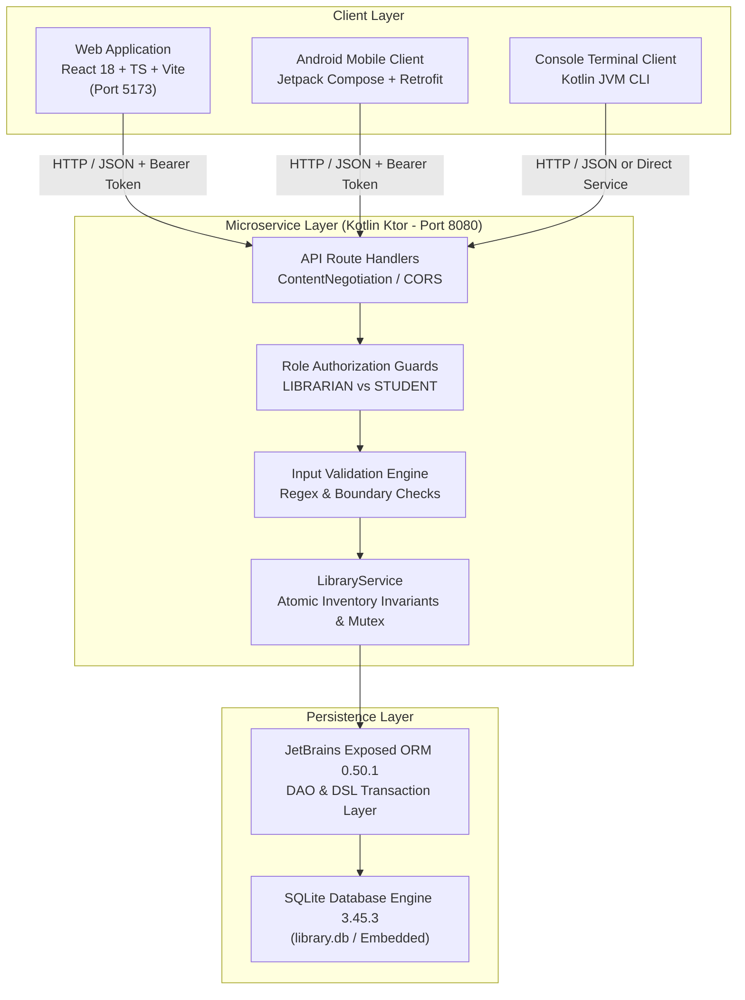
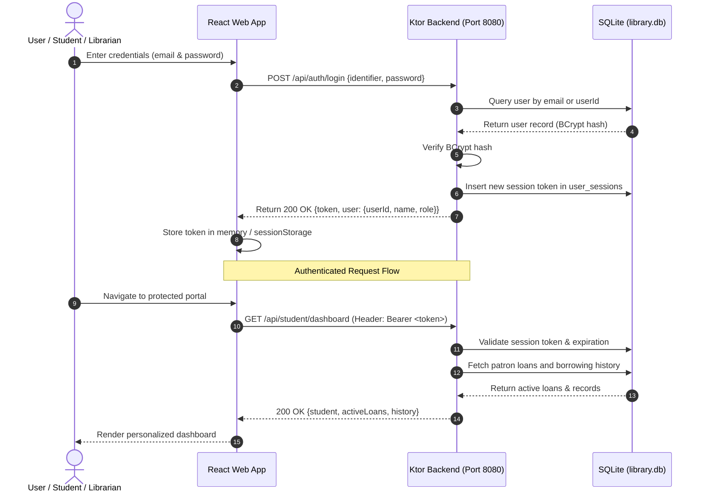

# System Architecture Specification
**Institute of Engineering & Management, Kolkata**  
*Library Management System*

---

## 1. Architectural Overview

The **IEM Library Management System** is architected as a decoupled, multi-client, service-oriented system. The application serves three distinct client interfaces from a unified, high-performance **Kotlin Ktor RESTful backend**, backed by an embedded **SQLite** database using **JetBrains Exposed ORM**.



---

## 2. Core Architectural Principles & Invariants

### Invariant 1: Physical Inventory Conservation
For every book $b$ in the library, the following mathematical invariant is enforced at all times:
$$0 \le \text{availableCopies} \le \text{totalCopies}$$

- **Issue Operation**: Requires $\text{availableCopies} \ge 1$. Atomic transaction decrements $\text{availableCopies}$ by 1 and records an active loan in `transactions`.
- **Return Operation**: Requires an active `ISSUED` transaction record matching the book and student. Atomic transaction increments $\text{availableCopies}$ by 1 and sets status to `RETURNED`.
- **Deletion Guard**: A book record cannot be deleted from the database if there are active loans ($\text{status} = \text{'ISSUED'}$) associated with it.

### Invariant 2: Concurrency Isolation & Mutex Locking
To prevent race conditions during concurrent book issues:
```kotlin
private val inventoryMutex = Mutex()

suspend fun issueBook(request: IssueRequest): IssueTransaction {
    return inventoryMutex.withLock {
        newSuspendedTransaction(Dispatchers.IO) {
            // Verify availability and decrement atomically
        }
    }
}
```

### Invariant 3: Role-Based Access Isolation (RBAC)
- **Public**: Unauthenticated read-only access to `/api/health`, `/api/books`, `/api/books/{id}`, and `/api/auth/login`.
- **Student Patron**: Authenticated with Bearer token. Can view personal profile, active loans, borrowing history, and search catalog. Forbidden from accessing librarian management routes.
- **Librarian Administrator**: Full access to circulation desk, book creation/editing, issue/return processing, member registry, and audit analytics.

---

## 3. Data Flow & Authentication Lifecycle



---

## 4. Multi-Client Ecosystem

1. **Web Dashboard (`frontend/`)**: Modern Single-Page Application (SPA) built with React 18, TypeScript, and Vite. Features interactive 3D physical book cards with perspective transforms, multi-layer living library parallax animations, and responsive layout.
2. **Android Mobile Client (`android/`)**: Native Android application built with Kotlin, Jetpack Compose, Material 3 design, and Retrofit HTTP client. Connects to `http://10.0.2.2:8080` (Android emulator loopback) or LAN IP.
3. **Console CLI Client (`console/`)**: Lightweight command-line interface built in Kotlin JVM. Provides a menu-driven terminal UI for managing books and student registries.

---

## 5. Technology Matrix

| Subsystem | Technology | Version | Purpose |
|---|---|---|---|
| Frontend Framework | React | 18.2.0 | Reactive component rendering |
| Frontend Language | TypeScript | 5.2.2 | Compile-time type safety |
| Frontend Bundler | Vite | 5.1.6 | Fast development server & HMR |
| Frontend Styling | Tailwind CSS | 3.4.1 | Utility-first responsive design |
| Frontend Icons | Lucide React | 0.344.0 | SVG icon library |
| Backend Framework | Ktor (Netty) | 2.3.12 | Asynchronous microservice engine |
| Backend Language | Kotlin | 1.9.23 | Modern JVM language |
| Database Engine | SQLite (Xerial JDBC) | 3.45.3.0 | Embedded persistence |
| Database ORM | JetBrains Exposed | 0.50.1 | Type-safe SQL abstraction |
| Password Security | jBCrypt | 0.4 | 12-round salted cryptographic hashing |
| Build Tool | Gradle Wrapper | 8.8 | Deterministic multi-project builds |
| Java Runtime | OpenJDK / Temurin | 17 LTS | Backend JVM runtime |
