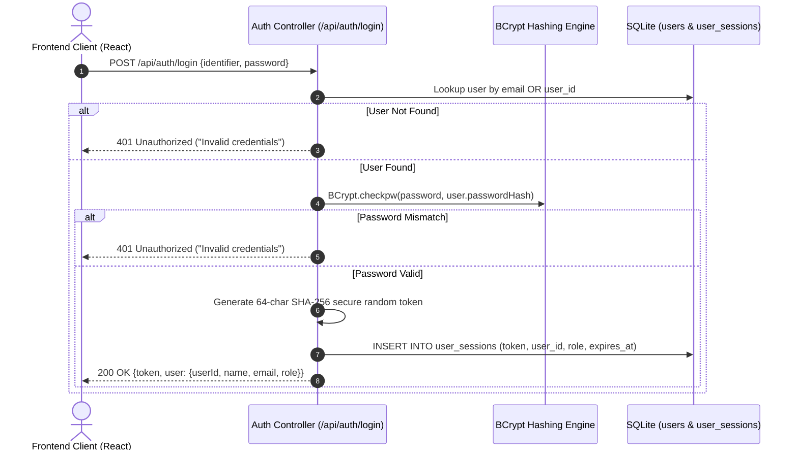

# Authentication & Access Control Architecture
**Institute of Engineering & Management, Kolkata**  
*Library Management System*

---

## 1. Security Architecture Overview

The IEM Library Management System implements a defense-in-depth, token-based authentication mechanism designed to protect institutional data while maintaining stateless REST scalability.



---

## 2. Password Security & Cryptographic Hashing

All user passwords stored in the database are protected using **BCrypt with 12 rounds of salting (`$2a$12$`)** via the `jBCrypt` library.
- **Salt Generation**: A unique cryptographic salt is generated for every user password.
- **Timing Attack Resistance**: Constant-time verification prevents side-channel timing analysis.
- **Zero Plaintext Storage**: Plaintext passwords are never stored in memory, logged, or written to disk.

---

## 3. Session Lifecycle & Bearer Tokens

- **Token Generation**: Upon successful authentication, a high-entropy 64-character cryptographic token is generated using `java.security.SecureRandom`.
- **Token Transmission**: Clients must provide the token in the HTTP `Authorization` request header:
  ```http
  Authorization: Bearer <64_character_hex_token>
  ```
- **Session Expiration**: Sessions expire automatically after 7 days (or 30 days if `rememberMe: true`).
- **Logout Invalidation**: Invoking `POST /api/auth/logout` deletes the active token record from `user_sessions`, instantly revoking access across all clients.

---

## 4. Role-Based Access Control (RBAC) Matrix

| Endpoint | Method | Public | Student | Librarian |
|---|---|:---:|:---:|:---:|
| `/api/health` | GET | Allowed | Allowed | Allowed |
| `/api/books` | GET | Allowed | Allowed | Allowed |
| `/api/books/{id}` | GET | Allowed | Allowed | Allowed |
| `/api/books/search` | GET | Allowed | Allowed | Allowed |
| `/api/auth/login` | POST | Allowed | Allowed | Allowed |
| `/api/auth/me` | GET | Denied | Allowed | Allowed |
| `/api/auth/logout` | POST | Denied | Allowed | Allowed |
| `/api/student/dashboard` | GET | Denied | Allowed | Allowed |
| `/api/student/borrowings`| GET | Denied | Allowed | Allowed |
| `/api/student/history` | GET | Denied | Allowed | Allowed |
| `/api/books` | POST | Denied | Denied | Allowed |
| `/api/books/{id}` | PUT | Denied | Denied | Allowed |
| `/api/books/{id}` | DELETE | Denied | Denied | Allowed |
| `/api/transactions/issue` | POST | Denied | Denied | Allowed |
| `/api/transactions/return`| POST | Denied | Denied | Allowed |
| `/api/dashboard/*` | GET | Denied | Denied | Allowed |
| `/api/students/*` | ALL | Denied | Denied | Allowed |

---

## 5. Development Demonstration Credentials

For development and evaluation purposes, the following verified demo accounts are automatically seeded on first launch:

| Role | Username / Identifier | Password | Access Privileges |
|---|---|---|---|
| **Librarian (Admin)** | `librarian@iemcal.ac.in` *(or `LIB001`)* | `admin123` | Full administrative console, circulation, catalog CRUD, audit analytics |
| **Student (Patron)** | `alex@iemcal.ac.in` *(or `S101`)* | `student123` | Student dashboard, active loan tracking, borrowing history, catalog search |
| **Student (Patron)** | `sarah@iemcal.ac.in` *(or `S102`)* | `student123` | Student dashboard, active loan tracking, borrowing history, catalog search |

---

## 6. Production Security Checklist

When deploying to a production institutional network:
1. **Enforce HTTPS**: Always terminate SSL/TLS via a reverse proxy (e.g. Nginx, Cloudflare, Caddy) so session tokens are never transmitted in cleartext.
2. **Rotate Demonstration Accounts**: Change the default passwords for `librarian@iemcal.ac.in` and test student accounts or disable seeding in production.
3. **CORS Restrictions**: Set `CORS_ORIGIN` in `.env` to the exact institutional domain (e.g., `https://library.iemcal.ac.in`) rather than wildcard `*`.
