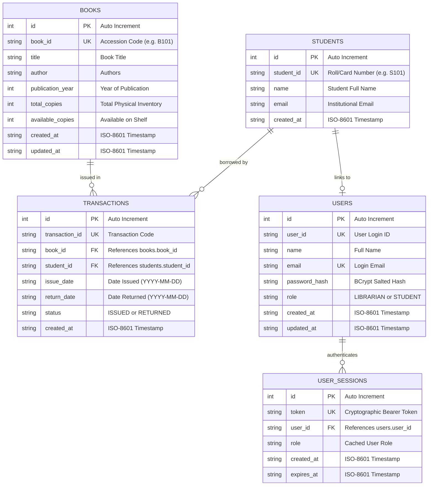

# Database Architecture & Entity Relationship Specification
**Institute of Engineering & Management, Kolkata**  
*Library Management System*

---

## 1. Entity-Relationship Model (ER Diagram)

---

## 2. Table Specifications

### 2.1. `books`
- **Purpose**: Physical inventory and publication catalog.
- **Indexes**:
  - `PRIMARY KEY (id)`
  - `UNIQUE (book_id)`
  - `INDEX idx_books_title (title)`
  - `INDEX idx_books_author (author)`
- **Constraints**:
  - `CHECK (total_copies >= 0)`
  - `CHECK (available_copies >= 0 AND available_copies <= total_copies)`

### 2.2. `students`
- **Purpose**: Official institutional student patron registry.
- **Indexes**:
  - `PRIMARY KEY (id)`
  - `UNIQUE (student_id)`
  - `INDEX idx_students_email (email)`

### 2.3. `transactions`
- **Purpose**: Circulation audit ledger recording book borrowings and returns.
- **Foreign Keys**:
  - `book_id` -> `books(book_id)` ON DELETE RESTRICT
  - `student_id` -> `students(student_id)` ON DELETE RESTRICT
- **Indexes**:
  - `PRIMARY KEY (id)`
  - `UNIQUE (transaction_id)`
  - `INDEX idx_transactions_book_id (book_id)`
  - `INDEX idx_transactions_student_id (student_id)`
  - `INDEX idx_transactions_status (status)`

### 2.4. `users`
- **Purpose**: Authentication registry for all system actors.
- **Indexes**:
  - `PRIMARY KEY (id)`
  - `UNIQUE (user_id)`
  - `UNIQUE (email)`
  - `INDEX idx_users_role (role)`

### 2.5. `user_sessions`
- **Purpose**: Ephemeral bearer authentication tokens.
- **Foreign Keys**:
  - `user_id` -> `users(user_id)` ON DELETE CASCADE
- **Indexes**:
  - `PRIMARY KEY (id)`
  - `UNIQUE (token)`
  - `INDEX idx_user_sessions_user_id (user_id)`

---

## 3. ORM Mapping & Thread Safety

The application utilizes **JetBrains Exposed ORM** with DAO & DSL patterns:
- Tables are defined in `backend/src/main/kotlin/com/librarymanagement/database/Tables.kt`.
- All database write transactions are executed inside `newSuspendedTransaction(Dispatchers.IO)`.
- Concurrent issue operations are guarded by a Kotlin Coroutine `Mutex` to guarantee serialization and prevent race conditions on book availability counts.
