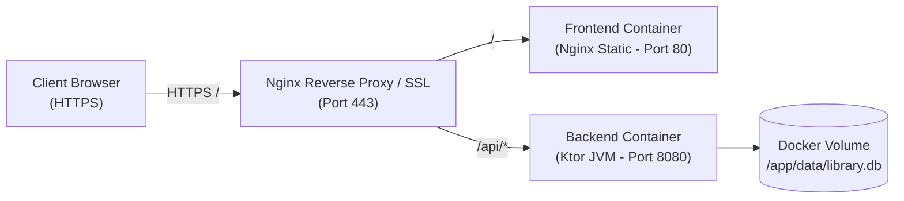

# Full-Stack Production Deployment Manual
**Institute of Engineering & Management, Kolkata**  
*Library Management System*

---

## 1. Important Architecture Notice

> [!IMPORTANT]
> **This is a FULL-STACK application**, consisting of a React Single-Page Application (SPA), a persistent Kotlin Ktor microservice, and a relational database.
> 
> **GitHub Pages, Netlify, or Vercel can only host the static frontend.** They cannot execute JVM bytecode or host the persistent Kotlin/SQLite backend. For a fully operational production deployment, you must host both tiers.

---

## 2. Deployment Architectures

### Architecture A: Containerized Full-Stack Deployment (Recommended)
Deploy both the frontend and backend together on a single VPS (DigitalOcean Droplet, AWS Lightsail, Linode, or Hetzner) using Docker Compose.



#### Steps:
1. Clone your repository onto the server:
   ```bash
   git clone https://github.com/YOUR_USERNAME/iem-library-management-system.git
   cd iem-library-management-system
   ```
2. Build and launch containers:
   ```bash
   docker-compose up -d --build
   ```
3. Verify status:
   ```bash
   docker-compose ps
   ```

---

### Architecture B: Split Cloud Deployment (PaaS)

- **Frontend**: Deploy `frontend/` to **Vercel**, **Netlify**, or **Cloudflare Pages**.
- **Backend**: Deploy `backend/` as a Docker web service to **Render**, **Railway**, or **Fly.io**.

#### 1. Backend Deployment (Render / Railway)
1. In your cloud dashboard, create a new **Web Service** pointing to your GitHub repository.
2. Set the root directory to `.` and specify Dockerfile path as `backend/Dockerfile`.
3. Configure persistent disk:
   - Mount path: `/app/data`
   - Size: 1 GB (plenty for thousands of books and transactions)
4. Set Environment Variables:
   - `PORT=8080`
   - `DATABASE_PATH=/app/data/library.db`
   - `CORS_ORIGIN=https://your-frontend.vercel.app`
5. Note your assigned backend URL (e.g. `https://iem-library-api.onrender.com`).

#### 2. Frontend Deployment (Vercel / Netlify)
1. Create a new project pointing to your GitHub repository.
2. Set Root Directory to `frontend`.
3. Build Settings:
   - Build Command: `npm run build`
   - Output Directory: `dist`
   - Install Command: `npm install`
4. Set Environment Variable:
   - `VITE_API_BASE_URL=https://iem-library-api.onrender.com/api`
5. Deploy.

---

## 3. Reverse Proxy & SSL Configuration (Nginx)

For standard Ubuntu/Debian Linux VPS installations:

```nginx
server {
    server_name library.iemcal.ac.in;

    # Frontend Static Files
    location / {
        root /var/www/iem-library/frontend/dist;
        try_files $uri $uri/ /index.html;
    }

    # Backend API Proxy
    location /api/ {
        proxy_pass http://127.0.0.1:8080/api/;
        proxy_http_version 1.1;
        proxy_set_header Upgrade $http_upgrade;
        proxy_set_header Connection 'upgrade';
        proxy_set_header Host $host;
        proxy_set_header X-Real-IP $remote_addr;
        proxy_set_header X-Forwarded-For $proxy_add_x_forwarded_for;
        proxy_set_header X-Forwarded-Proto $scheme;
    }

    listen 443 ssl;
    ssl_certificate /etc/letsencrypt/live/library.iemcal.ac.in/fullchain.pem;
    ssl_certificate_key /etc/letsencrypt/live/library.iemcal.ac.in/privkey.pem;
}
```

---

## 4. Production Hardening Checklist

- [ ] Obtain SSL certificate using Certbot: `certbot --nginx -d library.iemcal.ac.in`
- [ ] Configure automatic daily SQLite backups via cron:
  ```bash
  0 2 * * * sqlite3 /app/data/library.db ".backup '/app/backups/library_$(date +\%Y\%m\%d).db'"
  ```
- [ ] Disable test seed endpoint (`/api/seed`) or protect behind administrative VPN.
- [ ] Set strict `CORS_ORIGIN` headers matching the public frontend domain.
